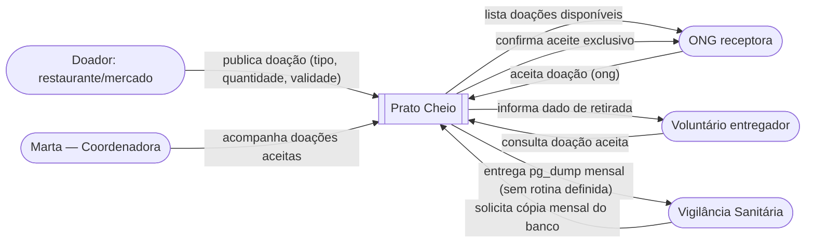

# Diagrama de contexto — Prato Cheio

**Pergunta:** Quem interage com o Prato Cheio e o que cada um troca com o sistema?

**Decisão que sustenta:** a fronteira da história zero (publicar → listar → aceitar, histórias #6/#7/#8 de `docs/analise.md`) e a Decisão #3 de `docs/projeto.md` (PostgreSQL instalado/contêiner local na Unidade 3, sem serviço de terceiro na borda do sistema).

**Situação:** retrato da `main` no commit `dbc7783` (proposta quanto à exigência de cópia mensal do banco para a Vigilância Sanitária, registrada no ADR 0001 > Revisão — 08/10/2026, ainda sem rotina automatizada).

6 elementos (dentro do limite de 9): Doador, ONG receptora, Voluntário entregador, Vigilância Sanitária, Marta, Sistema (Prato Cheio).
