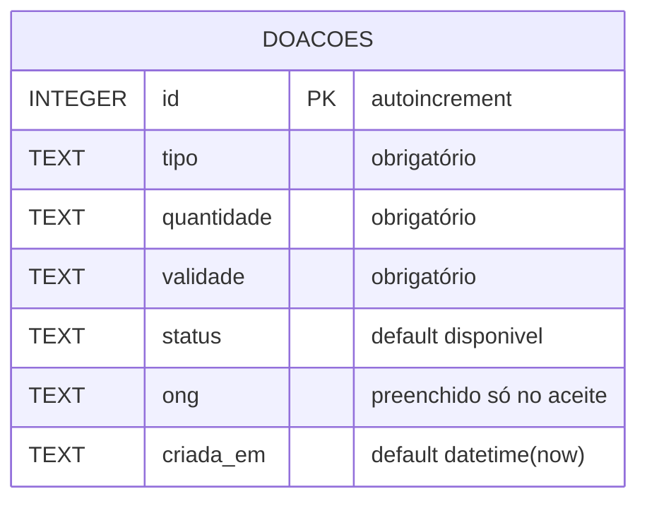

# Diagrama de dados — Prato Cheio

**Pergunta:** Quais dados o Prato Cheio guarda hoje sobre uma doação?

**Decisão que sustenta:** Decisão #1 (`UPDATE ... WHERE status='disponivel'` atômico para aceite exclusivo) e Decisão #2 (status `expirada` para doação vencida) de `docs/projeto.md`.

**Situação:** retrato da `main` no commit `dbc7783`, schema real de `src/db.js` > `migrar()`. Pendente de atualização após a Etapa 4b (guard de `limparBanco()`) e a Etapa 6 (status `coletada`), que não mexem no schema mas introduzem um novo valor de `status` e um arquivo de teste novo — quando entrarem, revisitar as divergências abaixo.

5 elementos (1 entidade + 4 atributos adicionais ao id, dentro do limite de 9).

## Três divergências entre este diagrama e `src/db.js`

1. **`status` é um TEXT livre no banco, sem `CHECK`/enum** — o diagrama mostra o campo como se tivesse um conjunto fechado de valores, mas na prática qualquer string é aceita. Hoje em uso: `disponivel`, `aceita`, `expirada` (Decisão #2, ainda sem código). A Etapa 6 propõe acrescentar `coletada` — ainda não implementado no momento deste diagrama.
2. **Nenhum índice existe no schema real** — `migrar()` não cria nenhum índice além da chave primária. Uma consulta como `listarDisponiveis()` (`WHERE status='disponivel'`) se beneficiaria de um índice em `status`, mas isso não está implementado; não presumir que existe.
3. **Não há coluna de timestamp de aceite** (`aceita_em` ou equivalente) — `criada_em` registra só a criação da doação. Uma eventual história como "Marta vê quantas doações foram aceitas no mês" (avaliada e descartada por ora na Etapa 6) exigiria essa coluna nova; o schema atual não suporta essa consulta com exatidão.
